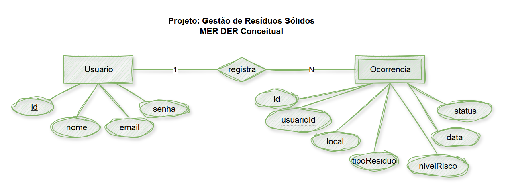
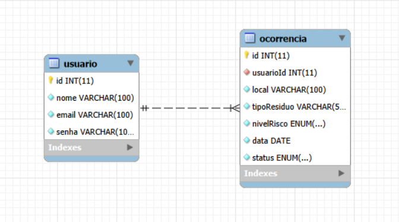
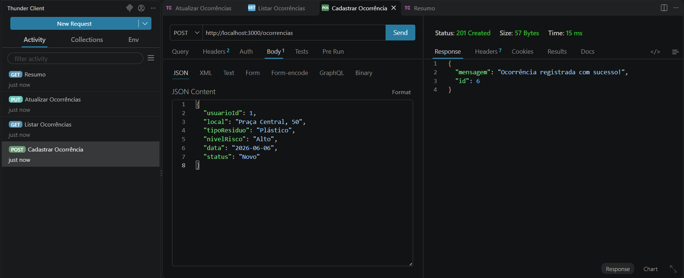
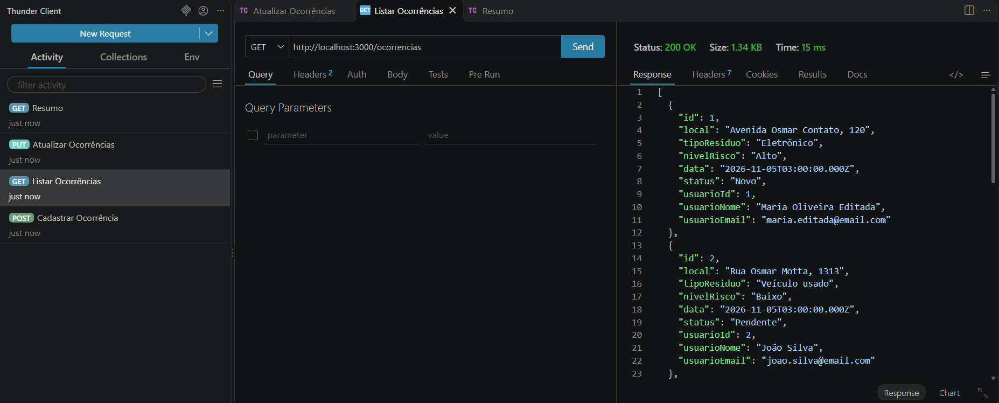
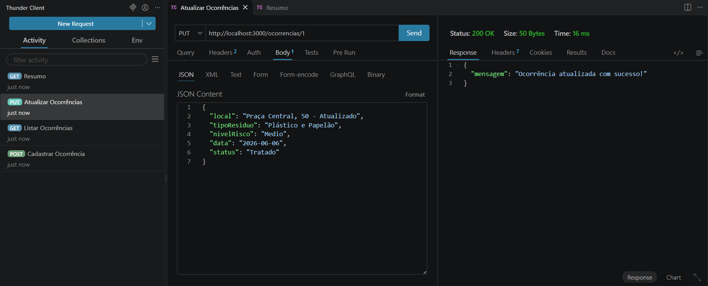
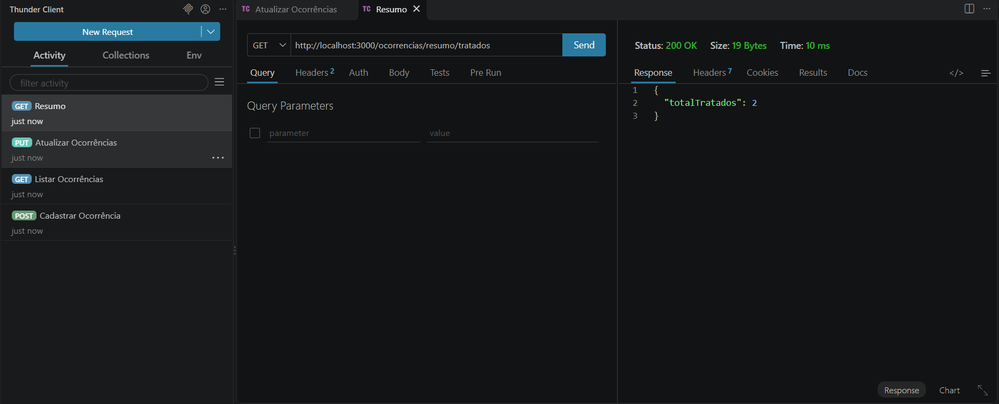

# Sistema de Gestão de Resíduos Sólidos – Prefeitura de Amparo

## Descrição

Este projeto foi desenvolvido durante as aulas do curso de Desenvolvimento de Sistemas do SENAI. Consiste em uma API back-end criada com Node.js, utilizando a arquitetura MVC e o banco de dados MariaDB.

O sistema permite registrar e acompanhar pontos de descarte irregular de resíduos na cidade de Amparo, como lixo, entulho e materiais eletrônicos. Também possui funcionalidades para cadastrar, consultar e atualizar usuários e ocorrências, além de realizar login.

## Diagramas

Os diagramas representam a estrutura do banco de dados e o relacionamento entre as tabelas do sistema.





## Tecnologias utilizadas

- Node.js
- Express
- MariaDB / MySQL
- XAMPP
- CORS
- Thunder Client / Postman / Insomnia

## Como executar o projeto

### 1. Pré-requisitos

- Node.js instalado.
- XAMPP instalado.
- Serviço MySQL iniciado pelo painel do XAMPP.

### 2. Configurar o banco de dados

Abra o MySQL Workbench ou outra ferramenta de gerenciamento e execute o arquivo `script.sql`, localizado na pasta `db`.

### 3. Instalar as dependências

Abra o terminal na pasta principal do projeto e execute:

```bash
npm install
```

### 4. Iniciar o servidor

Execute o comando:

```bash
npm run dev
```

O servidor estará disponível em:

`http://localhost:3000`

## Testes da API

Os testes foram realizados utilizando o Thunder Client para verificar o funcionamento das rotas.

### Testes de usuários

**Teste da rota inicial**


**Cadastro de usuário**


**Listagem de usuários**


**Atualização de usuário**


**Teste de login**


### Testes de ocorrências

**Cadastro de ocorrência**



**Listagem de ocorrências**



**Atualização de ocorrência**



**Resumo de ocorrências tratadas**

